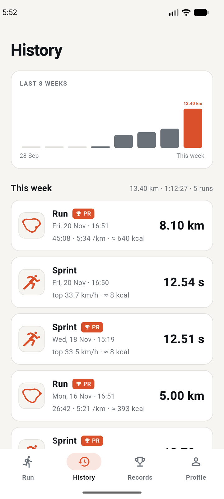
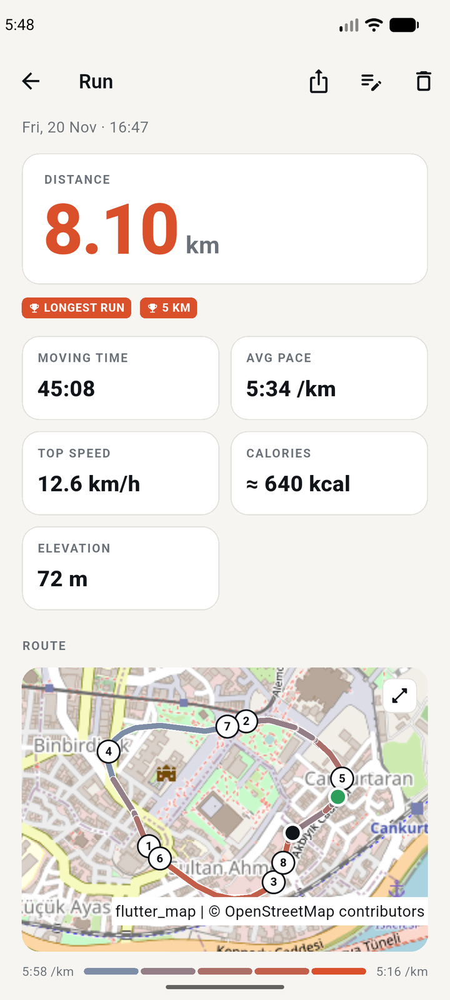
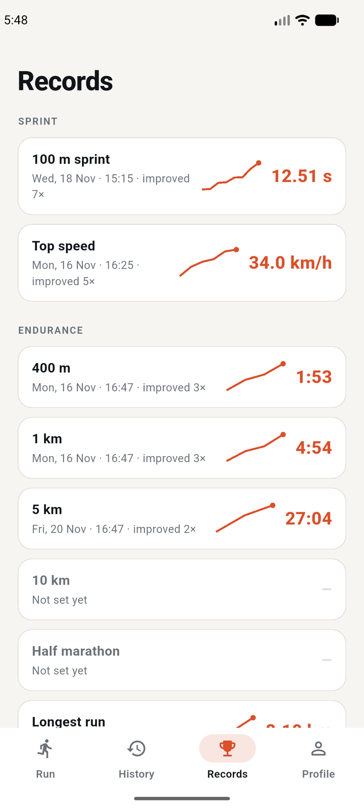
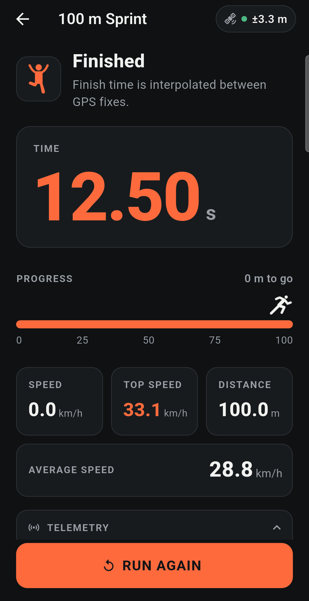
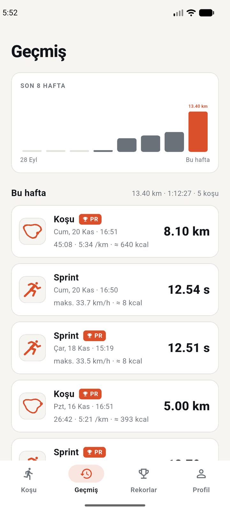

<p align="center">
  
</p>

<h1 align="center">Sprint Tracker</h1>

<p align="center">
  A Flutter running app for Android that times 100 m sprints and tracks longer runs with the
  phone in your pocket, using <b>raw GNSS Doppler speed</b> instead of noisy position differences.
</p>

<p align="center">
  
  &nbsp;
  
  &nbsp;
  
</p>
<p align="center">
  
  &nbsp;
  
  &nbsp;
  
</p>

<p align="center"><sub>Screenshots use the built-in demo mode with generated data (see below). Map data © OpenStreetMap contributors.</sub></p>

---

## Features

**Sprint (100 m)**
- GPS calibration, 3-second countdown, auto-stop at the finish line.
- Finish time interpolated between samples, 10 m splits, live speed and a lane-style progress bar.
- Clear warnings for missing permission, location off, no fix, weak signal and signal lost.

**Endurance runs**
- Runs in a foreground service: keeps tracking with the screen off or the app swiped away.
- Lock-screen notification with distance, time, pace and calories; **Pause** while running,
  **Resume / Finish** only while paused, so a phone in a pocket can't end the run by accident.
- **Auto-pause** with hysteresis (stops below 0.8 m/s for 5 s, resumes above 1.5 m/s for 2 s).
- **Voice cues** in Turkish or English every km/mile (total time and last split), plus pause,
  resume and GPS lost/back. Music ducks instead of stopping.
- Elevation gain from smoothed GPS altitude; calorie estimate from weight (ACSM equations).
- Crash recovery: an interrupted run can be continued, saved or discarded.

**History, records and maps**
- Weekly totals, route thumbnails, swipe to delete with undo, notes.
- Run detail on **OpenStreetMap**: route coloured by speed, broken at pauses, km markers;
  touching the speed chart marks the spot on the map.
- Personal records: 100 m, top speed, 400 m, 1 km, 5 km, 10 km, half marathon, longest run,
  each with its progression.
- **GPX export** through the share sheet (Strava, Garmin Connect…), one track segment per pause.

**General**
- English and Turkish UI (follows the phone, or pick one in Profile), km or miles.
- Everything stays on the phone (SQLite via drift).

## How speed and distance are measured

```
 GNSS chip ──(Doppler speed, ~1 Hz)──┐
 (raw "gps" provider)                │  correct
                                     ▼
                           ┌───────────────────┐
 Accelerometer ──(~50 Hz)─▶│ 1D Kalman filter  │──▶ speed, distance, finish time   (sprint)
 (gravity removed)  predict│  state = [d, v]   │
                           └───────────────────┘

 Doppler speed ──▶ trapezoid integral per pause segment ──▶ distance, pace   (endurance)
```

1. **Raw GNSS, not Fused.** The local plugin [`packages/raw_gnss`](packages/raw_gnss) listens to
   `LocationManager.GPS_PROVIDER` directly. geolocator always picks Google's Fused provider on
   Android 12+ and defaults to a 5 s interval; Fused also smooths and delays speed. Being a real
   plugin, it also works inside the foreground service's own Flutter engine.
2. **Doppler speed is the measurement.** The chip's `Location.getSpeed()` comes from carrier
   Doppler shift and is typically good to ±0.1–0.5 m/s, while position-to-position distance carries
   ±3–5 m per fix. Long runs integrate speed over time; only gaps longer than 5 s fall back to the
   straight line between fixes.
3. **Sprint Kalman filter:** predicts distance and speed at accelerometer rate and corrects speed
   with every fix, weighted by its `speedAccuracy`.
4. **Guards:** mocked or poor fixes are rejected, speeds are clamped to plausible values, and a
   lost signal never invents distance.

### Hardware limits

Measured on a Galaxy A54 (Exynos GNSS): fixes arrive at **1 Hz** and the receiver tracks **L1
only**; carrier phase is not exposed. That is enough for good speed, but a 100 m time still carries
roughly ±0.3–0.5 s of uncertainty.

## Project structure

```
lib/
├── core/            # formatting, calories, best efforts, route geometry, GPX, l10n helpers
│   ├── services/    # raw GNSS location stream, sprint sensor fusion
│   └── theme/ widgets/
├── data/            # drift database, repository, records
├── features/
│   ├── sprint/      # 100 m state machine and screen
│   ├── tracking/    # endurance engine (pure Dart), foreground service, voice cues, live screen
│   ├── history/     # list, run detail, GPX export
│   ├── map/         # OSM route map and tile-free previews
│   ├── records/ profile/ home/ shell/ demo/
└── l10n/            # app_en.arb, app_tr.arb (+ generated code)
packages/raw_gnss/   # local Flutter plugin: raw GPS provider stream
docs/PLAN.md         # feature plan (phases A–F)
```

## Getting started

Requirements: Flutter 3.29+ (Dart 3.7), an Android device with GPS.

```bash
git clone https://github.com/erkinavcii/Running_Tracker.git
cd Running_Tracker
flutter pub get
flutter run
```

Run outside with a clear view of the sky. For endurance runs on Samsung phones, allow the app to
run unrestricted when asked, otherwise the system may stop tracking in the background.

### Demo mode

Uses a seeded in-memory database (sprints plus endurance runs with routes) and a static sprint
screen, without touching GPS or your real data:

```bash
flutter run --dart-define=DEMO=finished    # or: ready, running, nogps
```

### Tests

```bash
flutter test
```

The tracking engine, auto-pause, voice cues, best efforts, records, route geometry, GPX and the
database are covered by unit tests; the main screens by widget tests.

### Windows build note

If Gradle fails with `Unable to establish loopback connection`, point the JVM temp folder to a short path:

```powershell
$env:TMP='C:\gtmp'; $env:TEMP='C:\gtmp'; $env:JAVA_TOOL_OPTIONS='-Djdk.net.unixdomain.tmpdir=C:\gtmp -Djava.io.tmpdir=C:\gtmp'; flutter build apk --debug
```

After changing plugin versions, a `flutter clean` may be needed before the next Android build.

## Roadmap

- [x] Sprint mode with raw GNSS and a Doppler-based Kalman filter
- [x] Run history, personal records and best efforts
- [x] Background tracking with lock-screen controls and crash recovery
- [x] Endurance mode: auto-pause, voice cues, elevation, calories
- [x] OpenStreetMap routes coloured by speed, chart/map sync
- [x] GPX export, English/Turkish UI
- [ ] Field-validate against timing gates and tune filter noise
- [ ] Heart-rate strap (BLE) for better calorie estimates
- [ ] Interval workouts and training plans
- [ ] Raw GNSS measurements (`GnssMeasurement`) for Doppler at the measurement level

## License

Private project. License TBD.
