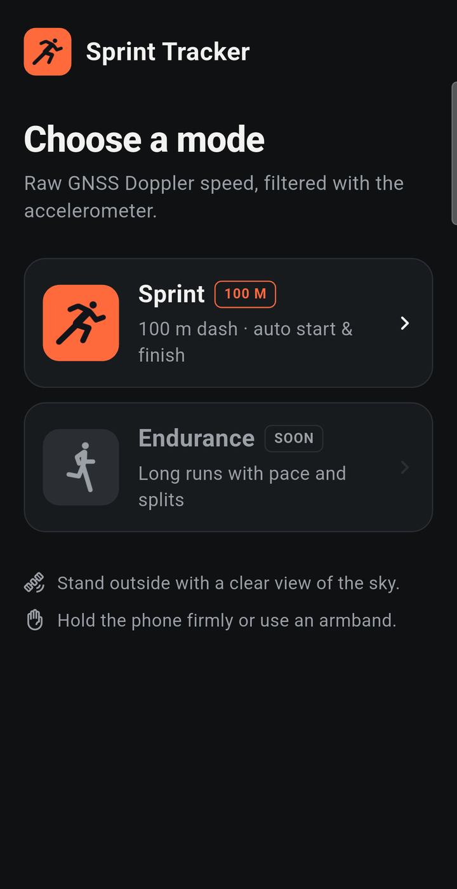
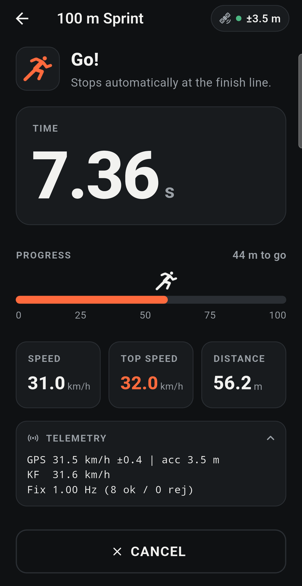

<p align="center">
  
</p>

<h1 align="center">Sprint Tracker</h1>

<p align="center">
  A Flutter app that times 100 m sprints with a phone, using <b>raw GNSS Doppler speed</b>
  and a small <b>Kalman filter</b> instead of noisy position differences.
</p>

<p align="center">
  
  &nbsp;
  
  &nbsp;
  
</p>

<p align="center"><sub>Screenshots use the built-in demo mode with randomised data (see below).</sub></p>

---

## Features

- **Sprint mode (100 m):** GPS calibration, 3-second countdown, auto-stop at the finish line.
- **Interpolated finish time:** the moment the 100 m line is crossed is interpolated between samples instead of using the next GPS tick.
- **Live metrics:** speed, top speed, distance, average speed, and a lane-style progress bar.
- **GPS status chip and warnings:** current accuracy, plus clear banners for missing permission, location off, no fix, weak signal and signal lost.
- **Telemetry panel:** raw GPS speed ± its accuracy, filtered speed and actual fix rate (Hz).
- **CSV logs** for every run in `Documents/SprintLogs/` (accelerometer, filter state and every GNSS fix).
- **Endurance mode:** planned.

## How speed and distance are measured

```
 GNSS chip ──(Doppler speed, ~1 Hz)──┐
 (raw "gps" provider)                │  correct
                                     ▼
                           ┌───────────────────┐
 Accelerometer ──(~50 Hz)─▶│ 1D Kalman filter  │──▶ speed, distance, finish time
 (gravity removed)  predict│  state = [d, v]   │
                           └───────────────────┘
```

1. **Raw GNSS, not Fused.** On Android the app listens to `LocationManager.GPS_PROVIDER` directly through a small Kotlin `EventChannel` ([`MainActivity.kt`](android/app/src/main/kotlin/com/example/sprint_tracker/MainActivity.kt)). geolocator always picks Google's Fused provider on Android 12+ and defaults to a 5 s interval; Fused also smooths and delays speed.
2. **Doppler speed is the measurement.** The chip's `Location.getSpeed()` comes from carrier Doppler shift and is typically good to ±0.1–0.5 m/s. Position-to-position distance carries ±3–5 m error per fix, which inflates distance over a short sprint.
3. **The Kalman filter** predicts distance and speed at accelerometer rate and corrects speed with every GNSS fix, weighted by the fix's `speedAccuracy`. Process noise grows with measured acceleration, so the filter follows the start explosively but stays calm at cruising speed.
4. **Guards:** mocked or poor fixes (accuracy > 25 m, speed accuracy > 2 m/s, duplicates) are rejected; when the phone is still and GPS reports ~0, speed is clamped to zero; if GPS goes silent for 2.5 s the speed decays instead of extrapolating.

### Hardware limits

Measured on a Galaxy A54 (Exynos GNSS): fixes arrive at **1 Hz** and the receiver tracks **L1 only** (0 L5 signals out of ~260k satellite reports), carrier-phase is not exposed. That is enough for good speed, but a 100 m time still carries roughly ±0.3–0.5 s of uncertainty. Apps like Radarbot get smooth car speed from the same chip because a car moves fast, steadily and under open sky.

## Project structure

```
lib/
├── core/
│   ├── services/
│   │   ├── location_service.dart       # Raw GNSS stream (native channel on Android)
│   │   └── sensor_fusion_service.dart  # Kalman filter + CSV logging
│   ├── theme/app_theme.dart            # Flat light/dark palette
│   └── widgets/pictogram.dart          # Tintable running pictograms
├── features/
│   ├── home/screens/home_screen.dart
│   └── sprint/
│       ├── providers/
│       │   ├── sprint_controller.dart       # State machine, finish interpolation
│       │   └── demo_sprint_controller.dart  # Randomised data for screenshots
│       └── screens/sprint_active_screen.dart
└── main.dart
assets/pictograms/                      # Generated with Qwen-Image (ComfyUI), alpha masks
```

## Getting started

Requirements: Flutter 3.29+ (Dart 3.7), an Android device with GPS.

```bash
git clone https://github.com/erkinavcii/Running_Tracker.git
cd Running_Tracker
flutter pub get
flutter run
```

Run outside with a clear view of the sky; calibration waits for a fix better than 10 m (15 s timeout).

### Demo mode

Shows a static, randomised sprint without touching GPS. Useful for screenshots and UI work:

```bash
flutter run --dart-define=DEMO=running    # or: ready, finished, nogps
```

### Windows build note

If Gradle fails with `Unable to establish loopback connection`, point the JVM temp folder to a short path:

```powershell
$env:TMP='C:\gtmp'; $env:TEMP='C:\gtmp'; $env:JAVA_TOOL_OPTIONS='-Djdk.net.unixdomain.tmpdir=C:\gtmp -Djava.io.tmpdir=C:\gtmp'; flutter build apk --debug
```

## Roadmap

- [x] Sprint mode MVP (GPS + sensors + UI)
- [x] Raw GNSS provider and Doppler-based Kalman filter
- [x] Interpolated finish time, GPS loss guard
- [x] Flat redesign with custom pictograms
- [ ] Field-validate against timing gates and tune filter noise
- [ ] Project acceleration onto the running direction (orientation-aware fusion)
- [ ] Endurance mode (pace, splits, pause/resume)
- [ ] Route map with speed colouring
- [ ] Raw GNSS measurements (`GnssMeasurement`) for Doppler at the measurement level

## License

Private project. License TBD.
